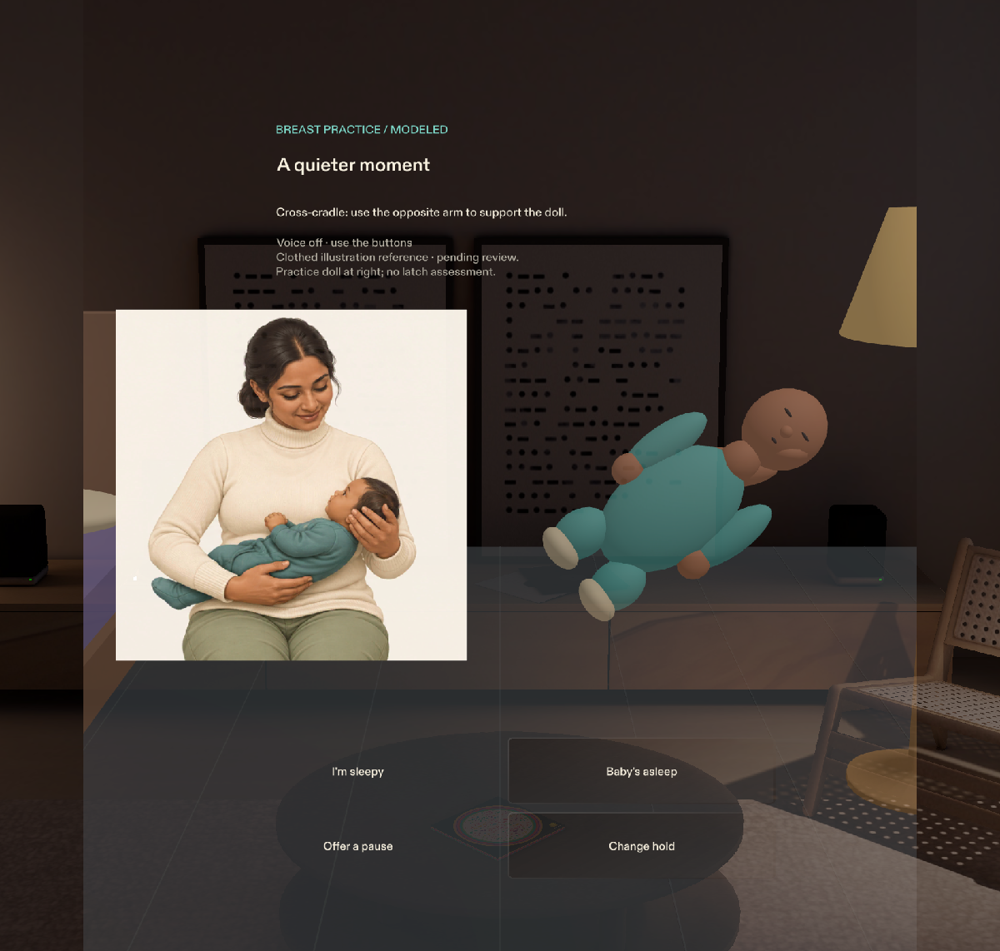
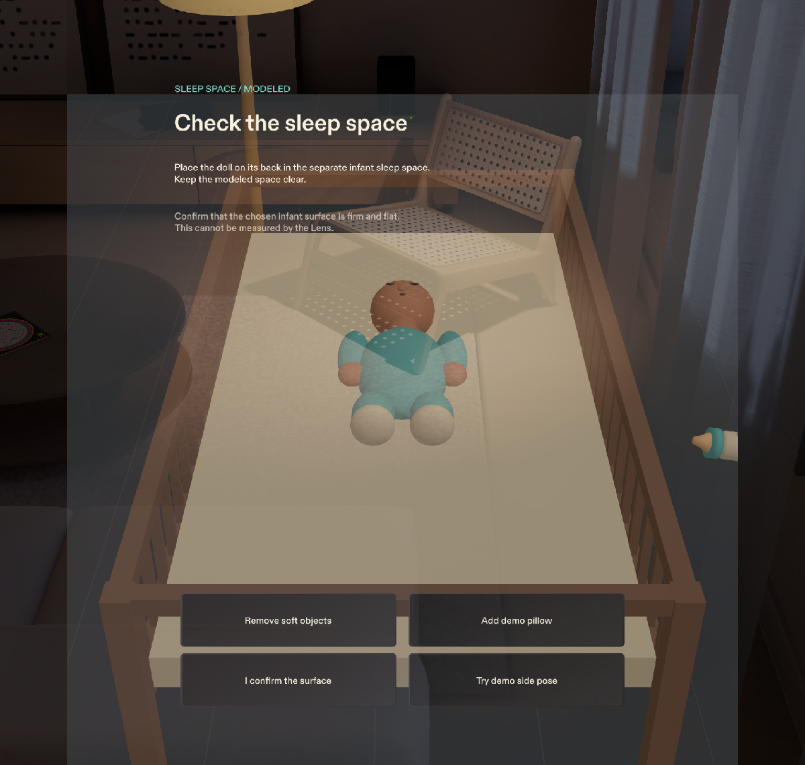

# Safe Night

**Spatial practice for feeding support and infant sleep placement, with one quiet cue at a time.**

Built for **Snap Specs** with **CLAD**, **Lens Studio**, and **TypeScript**. Demonstrated in **Lens Studio Preview**.



*Breast practice: a fully clothed caregiver reference beside the interactive practice doll.*



*Sleep practice: the doll on its back inside the separate modeled infant sleep space.*

> **Simulation-only prototype.** Safe Night uses a virtual nursery, a practice doll, and simulated inputs. It does not recognize or monitor a real infant. Guidance, illustrations, and geometric proxies await clinician review. It is not a medical device or a tool for assessing a real baby.

## The idea

Night feeding can leave a tired caregiver with little attention to spare. Safe Night explores a focused way to rehearse feeding support and the transition to a separate infant sleep space: show one relevant instruction near the task, allow time to make an adjustment, and make uncertainty visible.

The central interaction is simple. Move the practice doll away from its supporting-arm model. After a sustained change, a head-support cue appears. Return the doll to support, and the cue clears after a sustained correction.

The intended audience is mothers, other caregivers, and educators exploring these routines. Caregiver usability studies and clinical validation have not yet been conducted.

## The experience

| Stage | What you can practice |
|---|---|
| **Breast practice** | Select cradle, cross-cradle, or alongside placement. Change hold updates a fully clothed caregiver illustration and the corresponding doll placement. Manipulate the separate doll to explore modeled support cues. |
| **Bottle practice** | Move the doll and bottle, observe sustained-change cues, and correct the modeled position. |
| **Input uncertainty** | Simulate input loss. A violet dashed outline and an explicit unavailable state replace positioning feedback. Unknown never counts as a successful check. |
| **Handoff** | Select **I'm sleepy** or **Baby's asleep** to move toward a separate virtual infant sleep space. A direction label and quiet spatial chime help locate it outside the view. |
| **Sleep practice** | Try a side pose, correct the doll onto its back, check whole-doll containment, and remove simulated soft objects. Firmness and flatness require a separate user confirmation. |
| **Session review** | See modeled observations, user confirmations, unknown input, and untested conditions separately. There is no safety score. |

Breast practice covers modeled placement and support. It does not assess latch, milk transfer, or feeding effectiveness. The illustrations change through the hold control; they do not track free doll movement.

## Designed for spatial practice

- **Feedback near the task.** The active body cue appears at the relevant part of the virtual doll.
- **One instruction at a time.** A priority arbiter selects the current cue when modeled conditions compete.
- **Stable timing.** Sustained-change thresholds and separate clearing thresholds help prevent flickering feedback.
- **Explicit uncertainty.** Missing input produces a distinct unavailable state.
- **A destination in the world.** The infant sleep space is separate from the feeding position, with directional guidance during the handoff.

The prototype uses pinch interactions and explicit controls. Comfort, depth perception, and interaction suitability on Specs hardware remain unverified.

## Open and run

### Requirements

- **Lens Studio 5.24.1**
- The included Snap packages and **LEAF 2.0.2**
- **Node.js 24 or later** for the standalone logic tests

The clean submission folder includes actual binary assets and packages, with ordinary-Git attribute overrides. Git LFS is not required for that copy.

### Start a session

1. Open **`SafeNight.esproj`** in Lens Studio.
2. In Preview, select **SPECS 27 → Interactive → Evening Room** and resume playback.
3. Read the opening disclaimer and select **Enter the nursery**.
4. Choose **Breast practice** or **Bottle practice**, select an infant sleep-space category, and start practice.
5. Use pinch manipulation and the visible controls to explore the flow. Object scaling is locked to preserve the authored dimensions.

Use the explicit sleepy/asleep controls for the verified flow. **Try voice** is an optional ASR path; live microphone recognition has not been verified.

Keep **LEAF 2.0.2** pinned. LEAF 4.0.0 produced a vendor TypeScript compatibility error in this editor version.

## Verification

| Check | Recorded local result |
|---|---|
| Logic tests | **12 test groups passed** |
| Mutation checks | **All 10 deliberate mutations caught** |
| Preview regressions | **All 14 scenarios passed** |
| End-to-end rehearsal | **Passed** |

Run the standalone tests from the repository root. No npm dependency installation is needed:

```sh
npm test
npm run test:mutations
```

In Lens Studio, open the **LEAF panel**, keep **Execute on device off**, and run the `safe-night-*` scenarios in Preview. The pacing scenario takes about 50 seconds because it exercises the actual timer.

The tests cover geometry, whole-doll containment, oriented hazard volumes, dwell timing, hysteresis, cue priority, state transitions, evidence reporting, and missing input. Preview scenarios exercise the real controls and manipulation behavior.

See the [verification report](devpost/verification.md) for individual results and limitations. These checks establish prototype behavior, not clinical validity.

## Architecture

| Component | Responsibility |
|---|---|
| [SafeNightCore.ts](Assets/Scripts/SafeNightCore.ts) | Pure TypeScript rules, geometry, timing, cue arbitration, session state, and evidence handling |
| [SafeNightMain.ts](Assets/Scripts/SafeNightMain.ts) | Connects the Lens scene, user actions, simulated observations, and session flow |
| [SafeNightCardUI.ts](Assets/Scripts/SafeNightCardUI.ts) | Instruction card and explicit controls built with Spectacles UI Kit |
| [SafeNightDraggable.ts](Assets/Scripts/SafeNightDraggable.ts) | Spectacles Interaction Kit manipulation |
| [SafeNightNurseryMesh.ts](Assets/Scripts/SafeNightNurseryMesh.ts) | Procedural nursery, practice doll, and props |
| [SafeNightCaregiverReference.ts](Assets/Scripts/SafeNightCaregiverReference.ts) | Displays the selected fully clothed caregiver reference |

```text
SafeNight.esproj
Assets/
  Scripts/          Lens behavior and rendering
  Data/             Editable guidance, rules, and simulation parameters
  Images/           Caregiver reference atlas
  Materials/        Materials and shaders
  GeneratedSFX/     Synthesized spatial chime
  Tests/            Logic tests, mutation checks, and LEAF scenarios
  Tools/            Audio-generation source
Packages/           Snap SDK packages and pinned LEAF dependency
devpost/            Design brief, build history, test evidence, and screenshots
sources/            Guidance references and interpretation notes
```

Keep the package files and all asset **`.meta` files** when cloning or sharing the project. Lens Studio regenerates `Cache/`, `Support/`, and local workspace data; those folders are excluded from Git.

## Planning and implementation

The Lens was built by an AI coding agent through CLAD and the Lens Studio MCP. MCP tools supported scene construction, asset wiring, compilation, runtime inspection, Preview captures, and LEAF execution.

The initial implementation followed a user-approved brief. The official Devpost Learn skill pack was applied later in a documented post-build review. The [design brief](devpost/design-brief.md) and [build log](devpost/build-log.md) preserve that sequence.

## Scope and credits

Safe Night does not detect breathing, swallowing, or tiredness; certify an infant sleep environment; or demonstrate prevention of choking, suffocation, or infant death. Sleepiness is selected explicitly, and surface firmness is user-confirmed. No Specs hardware testing has been completed.

The caregiver references are original AI-generated illustrations with fully covered adult caregivers and clothed babies. They are placement references, not clinically validated latch diagrams. The nursery and practice doll use original procedural geometry; the chime was synthesized locally.

See [LIMITS.md](LIMITS.md), [asset provenance](ATTRIBUTION.md), and [guidance references](sources/README.md) for details.
