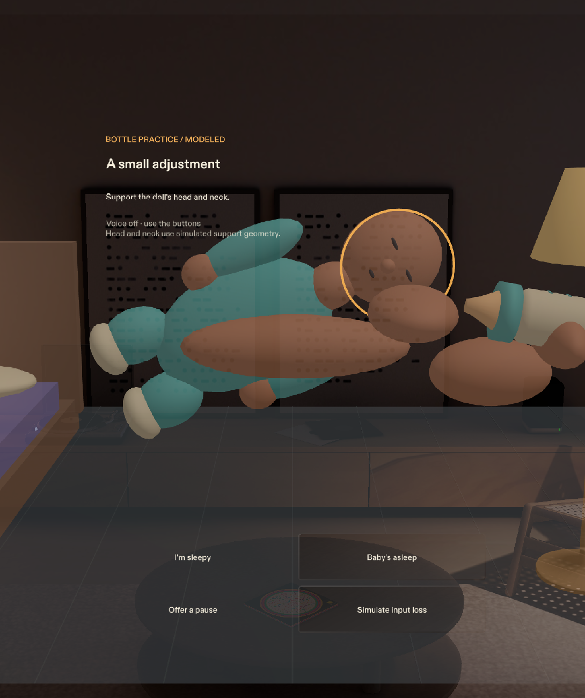

# Safe Night

A quiet practice space for a night feed, designed as a Specs Lens.



Local verification: **12 logic test groups passed, 10 mutations caught, and all 14 Preview regressions passed.** The complete demo rehearsal also passed. The scene is saved; delivery is local only. See [verification.md](devpost/verification.md) for evidence and remaining limits.

For the public source handoff, follow [what to push to GitHub](GITHUB_UPLOAD.md). The 2:55 demo has been recorded and its export verified; public video and repository uploads remain pending. The local MP4 and generated production media are intentionally excluded from Git.

**This is entirely a simulation: a virtual nursery, virtual newborn doll, and simulated interaction input. No hardware, real baby, or camera recognition is used. It is a guidance concept, not a monitor or medical device. All clinical wording and geometric proxies are pending clinician review. Do not use it to assess a real infant.**

The core moment is small: move the doll away from a simulated supporting arm, wait for one head-support cue, then return it and let the cue clear. A state machine continues through a sleepy/asleep response, a separate infant sleep space, a modeled hazard check, and a summary that distinguishes measured simulation geometry, user confirmation, and unknown input.

## Open and run

1. This clean submission contains actual binary assets and uses ordinary Git; Git LFS is not required for this handoff. Open `SafeNight.esproj` in **Lens Studio 5.24.1**. Keep **LEAF 2.0.2** pinned; importing LEAF 4.0.0 caused a vendor type error in this editor version.
2. In Preview, choose **SPECS 27 → Interactive → Evening Room**. Resume playback if it is paused.
3. Read the first-screen disclaimer, then choose **Enter the nursery → Bottle practice → Use this surface → Start practice**.
4. The doll, bottle, support models, and loose nursery objects use SIK manipulation. Scaling is locked to preserve their authored dimensions.
5. Use the explicit **I'm sleepy** and **Baby's asleep** buttons. **Try voice** is an opt-in ASR path; live microphone recognition remains unverified. The buttons remain available.

## Tests

Node 24 or later, no npm dependencies:

```sh
npm test
npm run test:mutations
```

Unit tests cover geometry, oriented hazard volumes, hysteresis and dwell timing, prompt priority and cooldown, state transitions, evidence aggregation, registry metadata, missing input, surface incline boundaries, and final-transcript command parsing. Mutation checks deliberately break ten conditions and require the tests to reject every mutation.

Open the **LEAF panel** and run the `safe-night-*` scenarios in Preview, with **Execute on device off**. The full list and observed results are maintained in [verification.md](devpost/verification.md). The pacing scenario takes about 50 seconds because it uses the actual demo timer.


## Evidence for review

| Criterion | Concrete evidence |
|---|---|
| Design | One instruction card; a separate quiet control strip; cues anchored to the doll; explicit unknown state; [accepted criteria](devpost/done-criteria.md) |
| Technical implementation | [Pure engine](Assets/Scripts/SafeNightCore.ts), [controller](Assets/Scripts/SafeNightMain.ts), [UIKit view](Assets/Scripts/SafeNightCardUI.ts), Node and LEAF tests |
| Innovation | A practice concept built around restraint and evidence levels; no recognition or monitoring claims |
| Presentation | [Approved brief](devpost/approved-brief.md), [build log](devpost/build-log.md), repeatable interaction scenarios and honest verification report |

## Project layout

- `Assets/Scripts/`: pure engine, passive UIKit view, procedural meshes, SIK manipulation, Lens controller.
- `Assets/Data/`: rule registry, editable PLACEHOLDER wording, one labeled demo-parameter file.
- `Assets/Tests/`: Node tests, mutation runner, LEAF scenarios, and demo/capture sequence.
- `Assets/GeneratedSFX/`: locally synthesized chime; no music or spoken narration.
- `Packages/`: required Snap SDK and LEAF packages.
- `devpost/` and `sources/`: submission documents and references; documentation captures stay outside runtime Assets to avoid Preview reloads during tests.

Read [LIMITS.md](LIMITS.md) before assessing the project. Sources are in [sources/README.md](sources/README.md); asset provenance is in [ATTRIBUTION.md](ATTRIBUTION.md). Local tests do not establish clinical validity, hardware usability, or a hackathon result.

Breast practice uses [fully clothed illustrated references](devpost/evidence/breast-cross.png), with the practice doll separately visible and bottle props hidden. Sleep practice explicitly checks [on-back placement](devpost/evidence/sleep-back.png) and whole-doll containment. See the [design brief](devpost/design-brief.md), [build log](devpost/build-log.md), and [verification report](devpost/verification.md).
